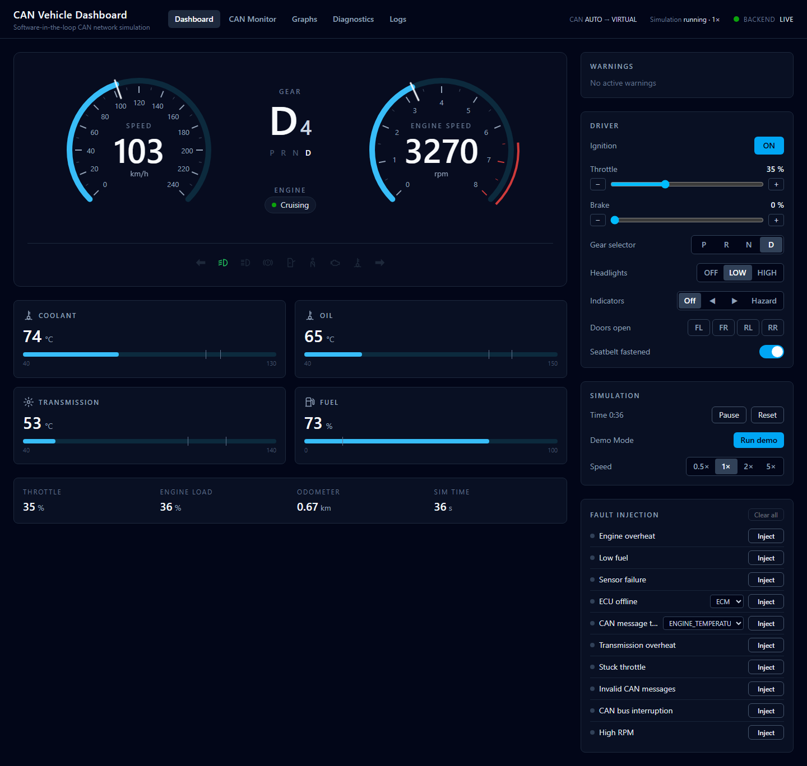
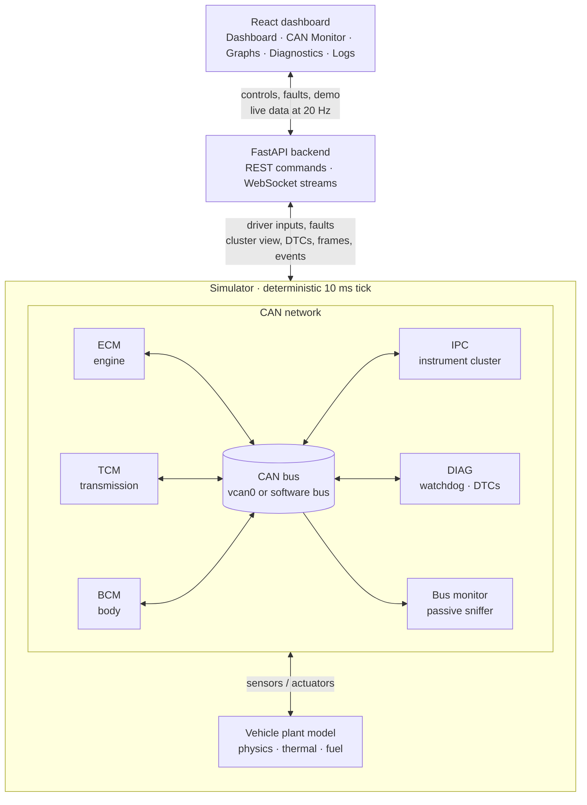
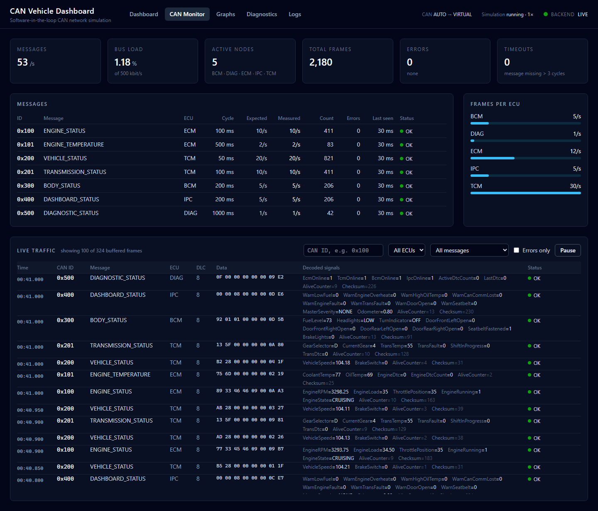
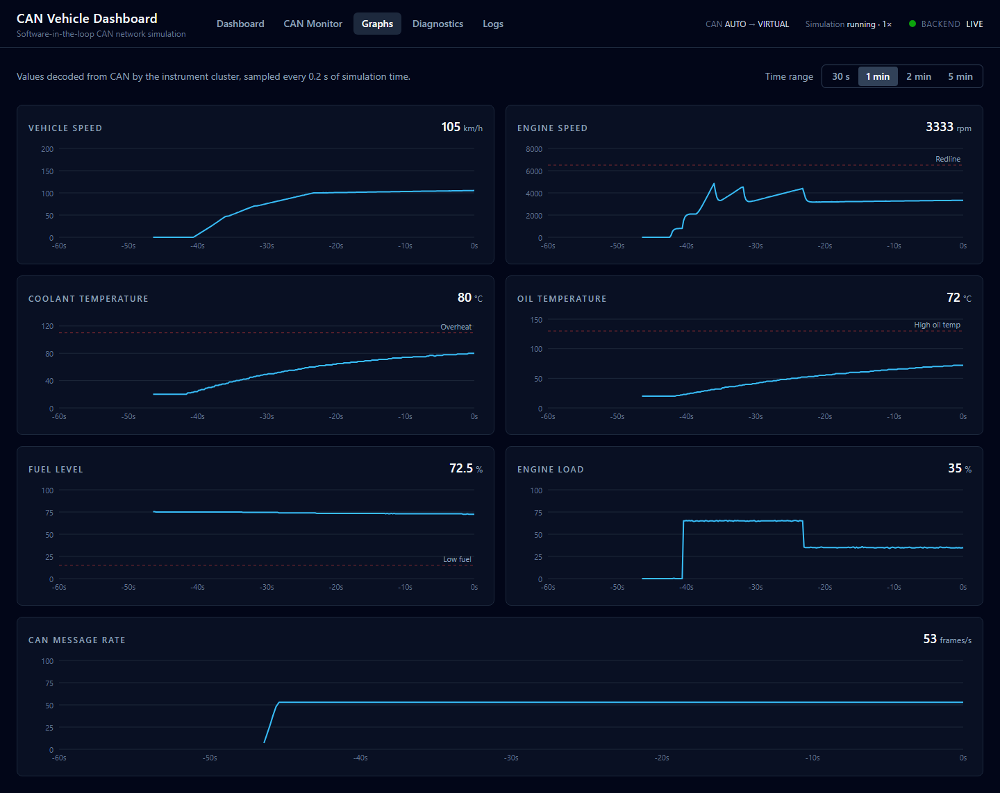
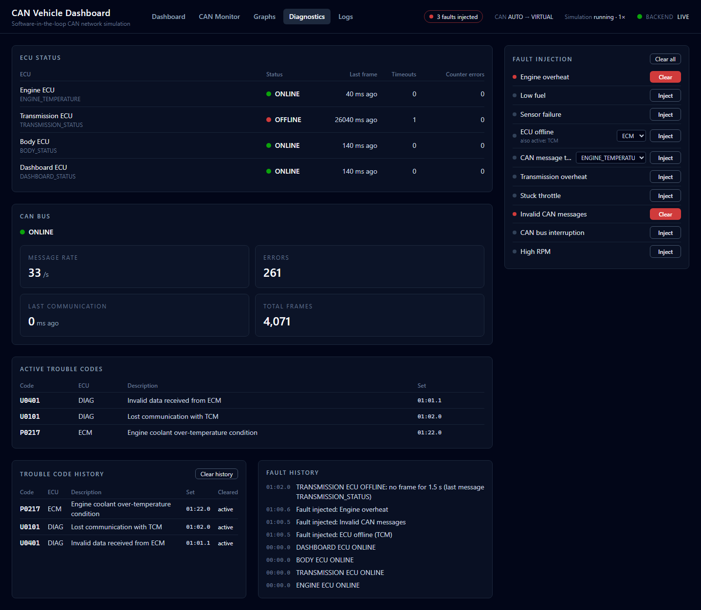
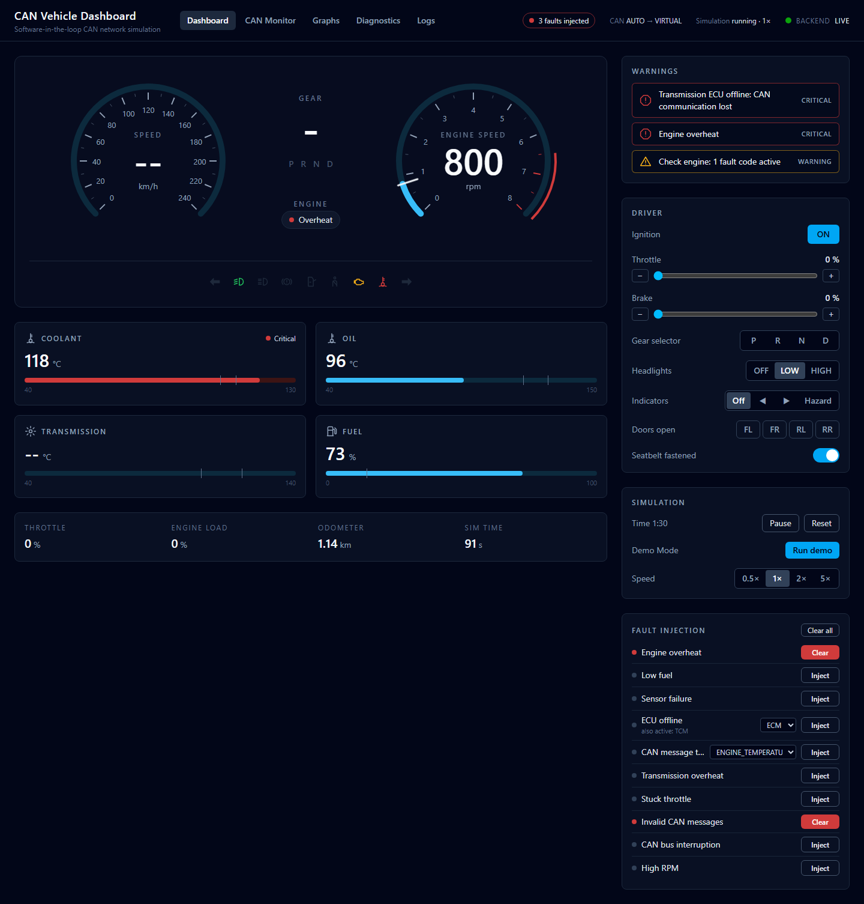
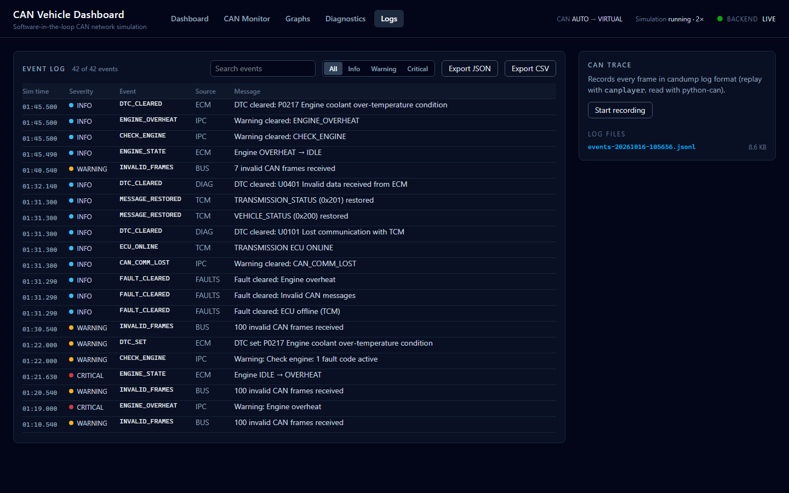
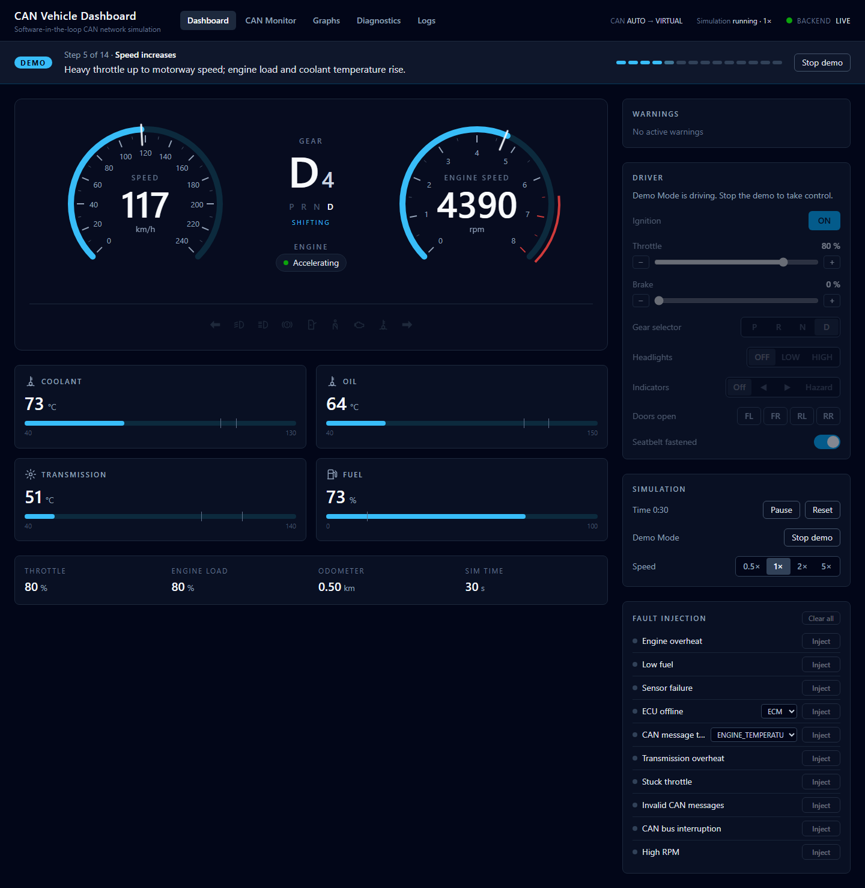

# CAN Bus Vehicle Dashboard

[](https://github.com/Esammy-88/can-vehicle-dashboard/actions/workflows/ci.yml)

A software-in-the-loop simulation of a small vehicle CAN network with a live
web dashboard. Five simulated ECUs drive a physics model of a car and talk to
each other only through DBC-encoded CAN 2.0 frames. The dashboard shows what
the instrument cluster decodes from that traffic, alongside a CAN analyser,
live graphs, fault injection, diagnostics and an event log. No hardware is
needed: on Linux it runs on SocketCAN (`vcan0`), and everywhere else on a
software CAN bus.



## Project Overview

A modern car is a network of controllers. The engine ECU doesn't *know* the
vehicle speed; it reads it from a CAN frame the transmission ECU sends 20
times a second. The cluster's gauges show whatever arrives on the bus, and
when a node goes silent, the others must notice. This project builds that
system in software, end to end:

- a **plant model** (engine torque curve, 6-speed automatic, drag, brakes,
  coolant/oil/transmission temperatures, fuel) plays the physical car;
- **ECUs** read noisy sensors, run their control logic and state machines,
  command actuators, and exchange cyclic CAN messages protected by an alive
  counter and a checksum;
- a **diagnostic node** supervises the network with a watchdog and OBD-II
  style trouble codes;
- **faults** are injected where they would physically happen (radiator,
  sensor wire, ECU power, bus wiring, a rogue node), and the network has to
  detect them on its own;
- a **React dashboard** visualises all of it in real time.

## Features

- **Five ECUs:** Engine (ECM), Transmission (TCM), Body (BCM), Instrument
  Cluster (IPC) and a Diagnostic monitor (DIAG). They exchange 7 messages, 53
  frames/s, all defined in one [DBC file](dbc/vehicle.dbc).
- **Driver controls:** ignition, throttle and brake pedals, P/R/N/D with a
  brake shift interlock, lights, indicators, doors, seatbelt.
- **Dashboard:** speed and RPM gauges, gear, engine state, temperature and
  fuel meters, telltales and a severity-ranked warning panel, all decoded
  from CAN.
- **CAN Monitor:** live decoded traffic (ID, DLC, raw bytes, signals, errors)
  with filters, per-message measured rate against the DBC cycle time, bus
  load, errors by type, timeouts and active nodes.
- **Graphs:** speed, RPM, temperatures, fuel, load and message rate over
  30 s – 5 min.
- **Ten injectable faults** with detection by the network itself: watchdog
  ECU timeouts, alive-counter checks, OBD-II DTCs (P0217, U0101, …), limp
  modes and plausibility checks.
- **Diagnostics page:** ECU health, bus status, active DTCs and history.
- **Event log and CAN traces:** JSON-lines log with JSON/CSV export, and
  candump-format traces for replay with `canplayer` or reading with python-can.
- **Demo Mode:** a one-click 14-step scenario from cold start to fault
  detection and recovery, for presenting the project.
- **Deterministic simulation:** a fixed 10 ms tick and seeded randomness, so
  the same inputs always give the same run. Real time at 0.5×–5× speed,
  with pause and reset.

## Architecture



The plant and the ECUs are separate, so ECUs only see sensors and CAN frames.
The simulator steps everything every 10 ms of simulated time, and a real-time
runtime keeps that in step with the wall clock. Two WebSocket streams push
the cluster view (20 Hz) and the raw CAN traffic (10 Hz) to the browser.
Full details in [docs/architecture.md](docs/architecture.md).

## Technologies

| Area | Stack |
|---|---|
| Simulation and API | Python 3.11+, FastAPI, Pydantic, asyncio |
| CAN | python-can (SocketCAN / virtual bus), cantools (DBC) |
| Frontend | React 19, TypeScript, Vite, Tailwind CSS (charts and gauges are hand-written SVG) |
| Quality | pytest, ruff, GitHub Actions |

## CAN Protocol

Classic CAN 2.0A: 11-bit IDs, 8-byte payloads, little-endian signals. Lower IDs
win arbitration, so powertrain messages have the highest priority.

| ID | Message | Sender | Cycle | Signals |
|---|---|---|---|---|
| `0x100` | ENGINE_STATUS | ECM | 100 ms | RPM, load, throttle, running, engine state |
| `0x101` | ENGINE_TEMPERATURE | ECM | 500 ms | Coolant, oil, active DTC, DTC count |
| `0x200` | VEHICLE_STATUS | TCM | 50 ms | Vehicle speed, brake switch |
| `0x201` | TRANSMISSION_STATUS | TCM | 100 ms | Selector, gear, fluid temperature, fault, shifting, DTC |
| `0x300` | BODY_STATUS | BCM | 200 ms | Fuel, lights, indicators, doors, seatbelt, brake lights |
| `0x400` | DASHBOARD_STATUS | IPC | 200 ms | Warning lamps, master severity, odometer |
| `0x500` | DIAGNOSTIC_STATUS | DIAG | 1000 ms | ECU online flags, DTC count, last DTC |

Every frame carries a rolling **alive counter** (byte 6) and a **checksum**
over the payload and the CAN ID (byte 7). Receivers reject corrupted,
wrong-length and unknown frames without crashing. The total load is about
1.2 % of a 500 kbit/s bus. Frame layout, arbitration, scheduling and signal
scaling are in [docs/can-protocol.md](docs/can-protocol.md).

## Installation

Prerequisites: **Python 3.11+**, **Node.js 20.19+** (22 recommended) and Git.

```bash
git clone https://github.com/Esammy-88/can-vehicle-dashboard.git
cd can-vehicle-dashboard

# Backend
python -m venv .venv
source .venv/bin/activate          # Windows: .venv\Scripts\activate
pip install -r requirements-dev.txt

# Frontend
cd frontend
npm install
cd ..
```

**Windows notes:**

- If `python` opens the Microsoft Store, Python isn't on your PATH. Use the
  launcher instead: `py -m venv .venv`.
- If PowerShell refuses to run `activate` or `npm` ("running scripts is
  disabled on this system"), run this once:
  `Set-ExecutionPolicy -Scope CurrentUser RemoteSigned`.
  Alternatively, call `npm.cmd` instead of `npm`.
- Quote paths that contain spaces: `cd "C:\My Projects\can-vehicle-dashboard"`.

**Optional, Linux only:** use a real SocketCAN interface instead of the
software bus:

```bash
sudo apt install can-utils         # candump, canplayer (optional tools)
./scripts/setup_vcan.sh            # creates vcan0; remove with --remove
```

## Running

**Windows, one click:** double-click `start-dev.cmd`. It opens the backend and
the frontend in two windows (keep both open), then the dashboard.

**Any platform**, from the repository root with the virtual environment
active:

```bash
# Terminal 1: backend on http://localhost:8000
uvicorn app.main:app --app-dir backend --reload --reload-dir backend

# Terminal 2: frontend on http://localhost:5173
cd frontend
npm run dev
```

Open **http://localhost:5173**. To drive, turn the **ignition** on, hold some
**brake** and select **D** (shift lock), then release the brake and add
**throttle**. Or click **Run demo**.

The backend picks the CAN bus automatically (`CAN_MODE=auto`): `vcan0` if it
exists, otherwise the software bus. Force one with `CAN_MODE=socketcan` or
`CAN_MODE=virtual`. Other settings are in
[docs/development.md](docs/development.md#configuration).

Without a browser, these print values decoded from the bus:

```bash
python scripts/start_simulation.py          # scripted ~60 s drive in real time
python scripts/start_simulation.py --demo   # the Demo Mode sequence, faults included
python scripts/can_demo.py                  # a few frames, including bad ones
```

Interactive API docs: http://localhost:8000/docs. The REST and WebSocket
endpoints are listed in [docs/architecture.md](docs/architecture.md#data-flow-to-the-browser)
and the [API table](#api) below.

## Dashboard

| Page | What it shows |
|---|---|
| **Dashboard** | What the instrument cluster ECU decoded from CAN: gauges, gear, engine state, meters, telltales, warnings. Plus driver controls, simulation controls and the fault panel. If an ECU goes silent, its values blank out and a *CAN communication lost* warning appears. |
| **CAN Monitor** | A software CAN analyser: every frame with raw bytes and decoded signals, filters, and bus statistics (rates against the DBC, bus load, errors, timeouts, active nodes). |
| **Graphs** | Time series of the main signals with thresholds and a shared crosshair. |
| **Diagnostics** | Watchdog status per ECU, bus status, active trouble codes, DTC and fault history. |
| **Logs** | The event log with search, severity filter and export, plus CAN trace recording and log file downloads. |

## Fault Injection

Faults act at the physical point of failure, and the dashboard shows only
what the network detected.

| Fault | Injected as | Detected as |
|---|---|---|
| Engine overheat | Cooling system failure | ECM OVERHEAT limp mode, DTC P0217 |
| Low fuel | Fuel leak | LOW FUEL warning |
| Sensor failure | Coolant sensor open circuit | ECM plausibility check, DTC P0118, substitute value |
| ECU offline | ECM, TCM or BCM powered off | Watchdog timeout after 1.5 s, DTC U0100/U0101/U0140 |
| CAN message timeout | One message stops | Bus monitor timeout, *communication lost* |
| Transmission overheat | Oil cooler failure | TCM limp mode (max 3rd gear), DTC P0218 |
| Stuck throttle | Pedal sensor stuck | Brake-throttle override, DTC P2299 |
| Invalid CAN messages | Rogue node: bad checksum, bad DLC, unknown ID | Frames rejected, error counters, DTC U0401 |
| CAN bus interruption | Wiring fault | All ECUs offline, DTC U0001 |
| High RPM | Engine runaway | Overspeed detection, DTC P0219 |

How each detection works (thresholds, watchdog, DTC lifecycle, logging):
[docs/fault-injection.md](docs/fault-injection.md).

## Testing

```bash
pytest                    # 172 tests, about a minute
ruff check . && ruff format --check .
cd frontend && npm run build   # strict type-check + production build
```

**Results:** 172 tests pass, plus 3 SocketCAN tests that run on Linux when
`vcan0` exists. Backend line coverage is about 98 %. CI
([.github/workflows/ci.yml](.github/workflows/ci.yml)) runs lint and tests on
Python 3.11 to 3.14 and builds the frontend. A separate job creates a real
`vcan0` and runs the SocketCAN tests and the full demo over it.

The project has also been verified by hand on a fresh Ubuntu live system
(Python 3.14): installed from this README, all 175 tests passed (none skipped)
and the dashboard ran on `vcan0`, with its traffic visible in `candump` and
Wireshark.

The simulation runs in simulated time, so tests drive minutes of driving in
milliseconds and give the same result every time. The strategy, layer by
layer, is in [docs/testing.md](docs/testing.md).

## Screenshots

| | |
|---|---|
|  **CAN Monitor:** decoded live traffic and bus statistics |  **Graphs:** a drive from standstill to 105 km/h |
|  **Diagnostics:** TCM offline, rogue node and overheat detected |  **Dashboard:** the same faults as the driver sees them |
|  **Logs:** every fault, detection and recovery in order |  **Demo Mode:** step 5 of 14 |

## Demo

<!-- Demo video: add the link or an embedded GIF here once recorded, e.g.
[](https://youtu.be/VIDEO_ID) -->

_Demo video: coming soon._

**Demo Mode** (*Run demo* on the Dashboard) plays a scripted drive with no
input needed. The engine starts, the car pulls away, shifts up to 120 km/h,
cruises, brakes and parks. Then the demo injects an engine overheat, which
the ECM detects (OVERHEAT, P0217). It also cuts the transmission ECU off the
bus: the watchdog reports the timeout (U0101) and then sees communication
recover. Finally the fault clears. A banner on every page explains each step.
The whole run takes about 2 minutes at 1× and is identical every time. See
[docs/demo-mode.md](docs/demo-mode.md).

## Engineering Concepts Demonstrated

| Concept | Where |
|---|---|
| **CAN** | DBC-defined frames, 11-bit IDs and arbitration priority, DLC checks, signal packing and scaling, error handling (`backend/app/can/`) |
| **Real-time systems** | Fixed 10 ms tick, cyclic message scheduling without drift, wall-clock catch-up, deadline-based timeouts (`simulation/runtime.py`, `ecus/base.py`) |
| **Embedded architecture** | Sensor → controller → actuator separation, a plant model, end-to-end protection (alive counter and checksum), similar in idea to AUTOSAR E2E profiles |
| **ECU communication** | Five nodes exchanging only CAN frames. Speed reaches the ECM over CAN, and the cluster builds its whole view from the bus |
| **Fault detection** | Plausibility checks, substitute values, limp modes, brake-throttle override, invalid-frame detection |
| **Watchdogs** | Per-ECU timeout supervision and alive-counter checking (`monitoring/watchdog.py`) |
| **State machines** | Engine OFF → STARTING → IDLE → … → OVERHEAT/FAULT; gearbox selector interlock and shift schedule (`ecus/engine.py`, `ecus/transmission.py`) |
| **Software-in-the-loop** | Controllers run unchanged against a simulated plant and bus, and on Linux the same code runs on SocketCAN |
| **Diagnostics** | OBD-II style DTCs (P0217, U0101, …) set and cleared by conditions, with history and a diagnostic CAN message |
| **Testing** | 172 deterministic tests from codec to API, about 98 % coverage, and CI including a real `vcan0` job |

## Documentation

| Document | Contents |
|---|---|
| [architecture.md](docs/architecture.md) | System structure, design decisions, data flow |
| [can-protocol.md](docs/can-protocol.md) | CAN frame, IDs, DLC, arbitration, scheduling, messages, signals |
| [ecu-design.md](docs/ecu-design.md) | Each ECU's logic and state machines, the physics model |
| [fault-injection.md](docs/fault-injection.md) | Fault scenarios, watchdog, DTCs, event log, traces |
| [demo-mode.md](docs/demo-mode.md) | The demo sequence and recording tips |
| [wireshark.md](docs/wireshark.md) | Capturing and reading `vcan0` traffic in Wireshark |
| [testing.md](docs/testing.md) | Test strategy and how to run the suites |
| [development.md](docs/development.md) | Setup, conventions, extending the project |

## API

| Endpoint | Purpose |
|---|---|
| `GET /api/health` | Backend status, configured and resolved CAN backend |
| `GET /api/state` | Snapshot: cluster view, controls, simulation, faults, diagnostics, demo |
| `POST /api/controls` | Partial update of driver inputs |
| `POST /api/simulation/{start,pause,reset}` | Simulation control |
| `PUT /api/simulation/speed` | `{"factor": 0.5 \| 1 \| 2 \| 5}` |
| `GET /api/can/stats`, `GET /api/can/frames?limit=N` | Bus statistics, recent decoded frames |
| `GET /api/history?seconds=N` | Graph history (up to 300 s) |
| `GET /api/faults`, `POST /api/faults`, `DELETE /api/faults[/{type}]` | Fault catalogue, inject, clear |
| `GET /api/diagnostics`, `DELETE /api/diagnostics/dtcs` | ECU health and DTCs, clear DTC history |
| `GET /api/logs`, `GET /api/logs/export?format=json\|csv` | Event log and export |
| `GET/POST /api/logs/trace`, `GET /api/logs/files[/{name}]` | CAN trace recording, log downloads |
| `GET /api/demo`, `POST /api/demo/{start,stop}` | Demo Mode |
| `WS /ws/telemetry`, `WS /ws/can` | Live snapshot (20 Hz) and CAN frames (10 Hz) |

## Authors

Sammy Eyongorock.

## License

MIT — see [LICENSE](LICENSE).
