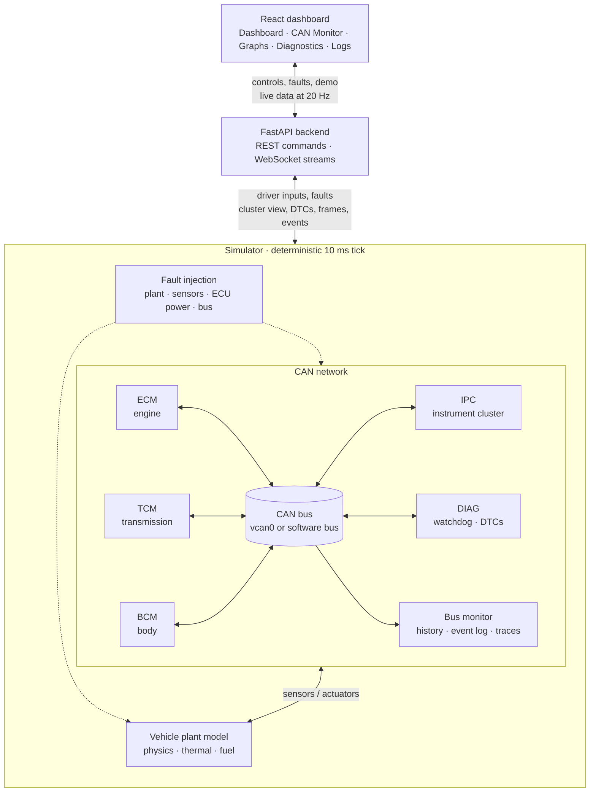
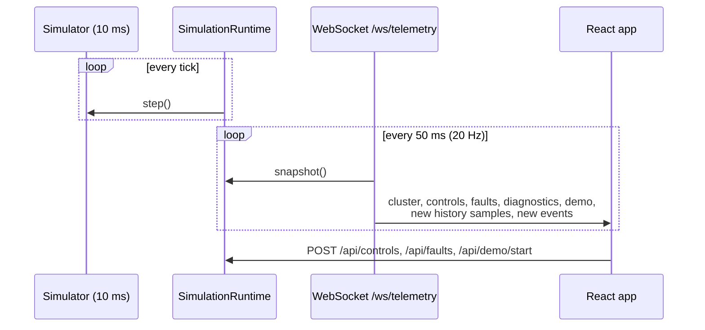

# Architecture

The project is a **software-in-the-loop (SIL)** simulation of a small vehicle
CAN network, with a web dashboard on top. Everything runs in one backend
process plus a browser. No hardware is involved.



## Layers

| Layer | Code | Responsibility |
|---|---|---|
| CAN | `backend/app/can/` | DBC loading and validation, encode/decode with counter and checksum, bus backend selection |
| ECUs | `backend/app/ecus/` | Controllers: each reads sensors and CAN, runs its logic, transmits its messages |
| Simulation | `backend/app/simulation/` | Plant model, sensors, faults, the tick loop, the real-time runtime, Demo Mode |
| Monitoring | `backend/app/monitoring/` | Bus statistics, graph history, watchdog, event log, CAN traces |
| API | `backend/app/api/` | REST control endpoints and the two WebSocket streams |
| Frontend | `frontend/src/` | React pages: Dashboard, CAN Monitor, Graphs, Diagnostics, Logs |

Dependencies point one way, left to right in the table: the CAN layer knows
nothing about ECUs, ECUs know nothing about the API, and the frontend only
sees JSON.

## Key design decisions

**The DBC is the single source of truth.** IDs, signal layout, scaling, senders
and cycle times all come from [`dbc/vehicle.dbc`](../dbc/vehicle.dbc). The
codec, the ECU transmit schedulers, the bus monitor's expected rates and the
tests all read the DBC, so changing a cycle time there changes it everywhere.
The loader rejects a DBC that breaks the project conventions, such as a
missing checksum or a DLC other than 8.

**ECUs talk only over CAN.** An ECU reads the plant through its own *sensors*
(with seeded noise and fault overrides), commands it through *actuators*, and
learns everything else from frames. The instrument cluster in particular
builds its whole view from decoded CAN. The dashboard shows that view, never
simulation internals, so a lost message really blanks the gauge it feeds.

**Plant and controllers are separate.** `VehicleModel` is the physical car:
engine torque curve, gearbox ratios, drag, rolling resistance, brake force,
coolant and oil warm-up, fuel use. The ECUs are the software under test.
Faults are injected where they would happen physically (radiator, sensor
wire, ECU power, bus wiring), so detection has to work the way it would in a
car.

**Deterministic simulated time.** `Simulator.step()` advances exactly 10 ms.
ECUs step in node order, then the plant integrates, then passive observers
record. Given the same seed and inputs, a run is identical, which is what makes
the tests (and Demo Mode) reproducible. `SimulationRuntime` turns this into
real time: an asyncio task wakes about every 10 ms and runs as many ticks as
the wall clock (× speed factor) calls for, catching up if the OS sleeps too
long.

**One bus node per ECU.** `BusFactory.open()` gives each ECU, the monitor and
the fault injector's rogue node its own bus instance, like separate
transceivers. With SocketCAN these are real sockets on `vcan0`, visible to
`candump` and Wireshark. Without it, python-can's in-process virtual bus
behaves the same way.

**Failures stay contained.** An ECU that raises an exception is marked crashed
and taken off the bus, and the rest of the network carries on. The
decoder never raises: bad frames are returned tagged with an error type so
the monitor and diagnostics can report them.

**Single-threaded backend.** The simulation loop and the request handlers all
run on the asyncio event loop thread, so REST handlers can change driver
inputs without locks.

## Data flow to the browser



- **`/ws/telemetry`** (20 Hz) sends the snapshot plus only the *new* graph
  samples and log events since the last message. On a simulation reset it
  sends `reset: true` so the client clears its buffers.
- **`/ws/can`** (every 100 ms) sends new decoded frames and bus statistics
  for the CAN Monitor.
- **REST** carries commands (controls, simulation, faults, demo, trace
  recording) and one-off reads (catalogue, log files, exports).

On the frontend, `useTelemetry` holds the stream at the top of the app, so
graph history keeps filling whichever page is open. The heavy pages are
memoised, so the 20 Hz updates only re-render what changed.

## Directory layout

```
backend/app/
  can/          bus.py (backend selection), dbc_loader.py, decoder.py, frames.py
  ecus/         base.py (scheduler, rx store), engine.py, transmission.py, body.py,
                dashboard.py (IPC), diagnostics.py (DIAG), dtc.py
  simulation/   vehicle.py, physics.py, sensors.py, faults.py, simulator.py,
                runtime.py, demo.py
  monitoring/   bus_monitor.py, history.py, watchdog.py, event_log.py, can_trace.py
  api/          routes.py, websocket.py
  config.py, main.py
backend/tests/  pytest suite (see testing.md)
dbc/            vehicle.dbc
frontend/src/   pages/, components/, hooks/, services/api.ts, types/api.ts
scripts/        setup_vcan.sh, start_simulation.py, can_demo.py
docs/           this documentation
```

## Further reading

- [can-protocol.md](can-protocol.md): frames, IDs, arbitration, scheduling, the message table
- [ecu-design.md](ecu-design.md): each ECU's logic and state machines
- [fault-injection.md](fault-injection.md): faults, watchdog, DTCs, logging
- [demo-mode.md](demo-mode.md): the automated demonstration
- [testing.md](testing.md): test strategy
- [development.md](development.md): working on the project
